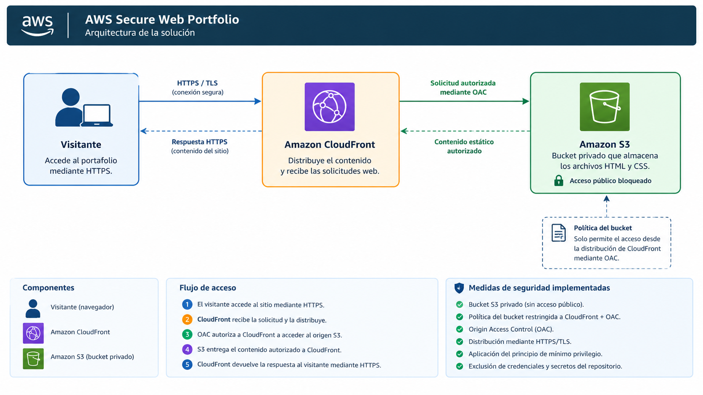
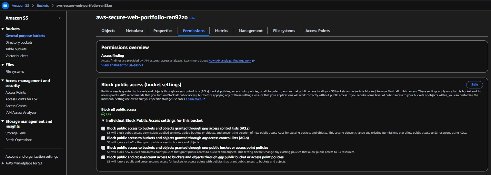
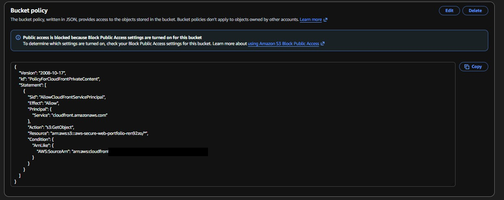
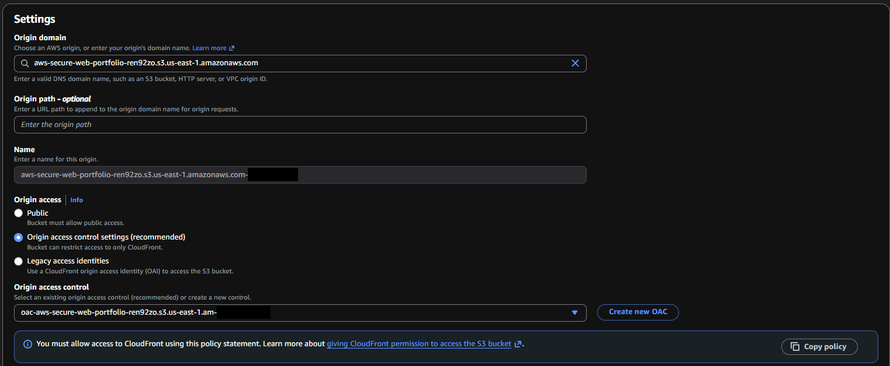
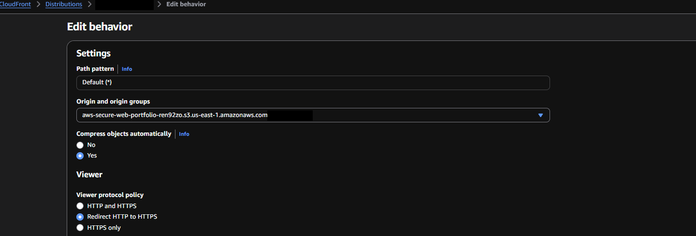
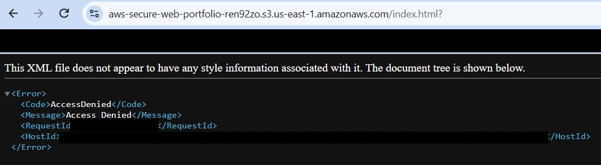
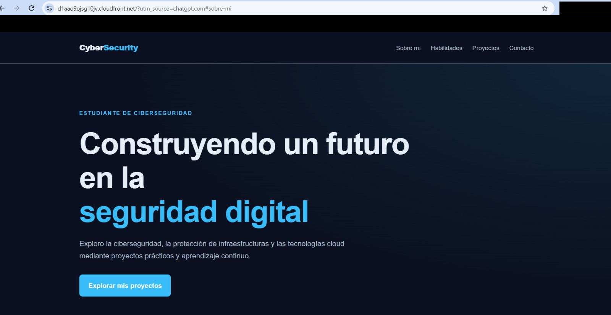
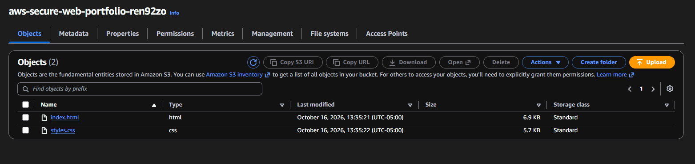
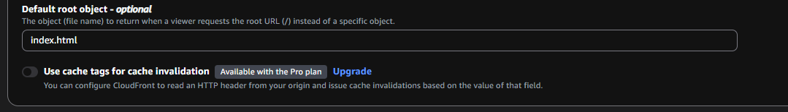

# AWS Secure Web Portfolio

Portafolio web estático alojado en AWS con **Amazon S3 + Amazon CloudFront**, usando un origen privado protegido con **Origin Access Control (OAC)**, HTTPS obligatorio y buenas prácticas de seguridad cloud.

---

## 1. Descripción del proyecto

Proyecto práctico de ciberseguridad cloud que consiste en desplegar un portafolio web estático en Amazon Web Services (AWS).

Los archivos del sitio se almacenan en un bucket privado de Amazon S3 y se distribuyen mediante Amazon CloudFront. El bucket **no es público**: solo la distribución de CloudFront, autorizada mediante OAC, puede leer sus objetos. Los visitantes acceden únicamente a través de HTTPS.

El proyecto demuestra la aplicación de controles de acceso, protección del origen, comunicación cifrada y buenas prácticas de gestión de costos, **respaldados con evidencia verificable** (capturas de configuración y pruebas desde terminal).

## 2. Objetivos

- Desplegar un sitio web estático mediante servicios de AWS.
- Almacenar los archivos del sitio en un bucket privado de Amazon S3.
- Distribuir el contenido mediante Amazon CloudFront con HTTPS.
- Configurar Origin Access Control (OAC) para controlar el acceso al origen.
- Validar el funcionamiento del sitio y la denegación del acceso directo a S3.
- Revisar el uso de los servicios y la información de facturación.
- Documentar las decisiones técnicas y los controles de seguridad implementados.

## 3. Arquitectura

**Flujo de acceso:**

```
Visitante → HTTPS/TLS → Amazon CloudFront → OAC → Bucket privado de Amazon S3
```

Amazon CloudFront distribuye el contenido y utiliza Origin Access Control (OAC) para autorizar sus solicitudes al origen S3. El bucket permanece privado, sin necesidad de habilitar acceso público a sus objetos. Esta arquitectura separa la distribución del contenido de su almacenamiento y reduce la exposición directa del origen.

### Diagrama de arquitectura



## 4. Servicios y tecnologías

| Tecnología | Función en el proyecto |
|---|---|
| **Amazon S3** | Almacenamiento de los archivos estáticos del sitio (bucket privado, región `us-east-1`). |
| **Amazon CloudFront** | Distribución del contenido y terminación HTTPS. |
| **Origin Access Control (OAC)** | Autorización firmada de CloudFront hacia el origen S3. |
| **HTTPS/TLS** | Cifrado de la comunicación entre el navegador y CloudFront. |
| **Cifrado en reposo (SSE-S3, AES-256)** | Cifrado de los objetos almacenados en S3. |
| **HTML5 y CSS3** | Estructura y presentación del sitio. |
| **GitHub** | Alojamiento del código fuente y la documentación. |

## 5. Controles de seguridad implementados

| Control | Implementación | Evidencia |
|---|---|---|
| Bucket privado | Block Public Access activado en sus cuatro opciones. | [Evidencia 1](#evidencia-1) |
| Mínimo privilegio | La política solo permite `s3:GetObject`, únicamente al servicio `cloudfront.amazonaws.com` y solo desde una distribución concreta (`AWS:SourceArn`). | [Evidencia 2](#evidencia-2) |
| Protección del origen | CloudFront accede al bucket mediante OAC; no se usa acceso público ni identidades heredadas (OAI). | [Evidencia 3](#evidencia-3) |
| Cifrado en tránsito | Política de visualizador "Redirect HTTP to HTTPS". | [Evidencia 4](#evidencia-4) · [Validación 6.3](#validacion-63) |
| Cifrado en reposo | Los objetos se almacenan cifrados con AES-256 (cabecera `x-amz-server-side-encryption`). | [Validación 6.1](#validacion-61) |
| Acceso directo denegado | Las solicitudes directas al objeto en S3 devuelven `403`. | [Evidencia 5](#evidencia-5) · [Validación 6.2](#validacion-62) |
| Higiene del repositorio | Sin credenciales, claves ni archivos de facturación; identificadores de cuenta y de petición redactados. | [Sección 9](#privacidad) |

### Política del bucket

El ID de cuenta y el ID de la distribución se reemplazaron por marcadores.

```json
{
  "Version": "2008-10-17",
  "Id": "PolicyForCloudFrontPrivateContent",
  "Statement": [
    {
      "Sid": "AllowCloudFrontServicePrincipal",
      "Effect": "Allow",
      "Principal": {
        "Service": "cloudfront.amazonaws.com"
      },
      "Action": "s3:GetObject",
      "Resource": "arn:aws:s3:::aws-secure-web-portfolio-ren92zo/*",
      "Condition": {
        "ArnLike": {
          "AWS:SourceArn": "arn:aws:cloudfront::<ACCOUNT_ID>:distribution/<DISTRIBUTION_ID>"
        }
      }
    }
  ]
}
```

La condición `AWS:SourceArn` es la que impide que otra distribución de CloudFront, de esta u otra cuenta, pueda leer el bucket: el permiso queda atado a una sola distribución.

## 6. Validaciones realizadas

Las pruebas se ejecutaron con `curl.exe -I` desde PowerShell. Los identificadores de petición (`X-Amz-Cf-Id`, `x-amz-request-id`, `x-amz-id-2`) y el identificador de la cabecera `Via` fueron reemplazados por `<redactado>`.

<a id="validacion-61"></a>

### 6.1. Disponibilidad del sitio a través de CloudFront

```
$ curl.exe -I https://d1aao9ojsg10jv.cloudfront.net/
HTTP/1.1 200 OK
Content-Type: text/html
Content-Length: 7019
Connection: keep-alive
Server: AmazonS3
Date: Sun, 18 Oct 2026 03:05:10 GMT
Last-Modified: Fri, 16 Oct 2026 18:35:21 GMT
ETag: "f97f86fa4b68467035207cb0ee38700f"
x-amz-server-side-encryption: AES256
Accept-Ranges: bytes
X-Cache: Hit from cloudfront
Via: 1.1 <redactado>.cloudfront.net (CloudFront)
X-Amz-Cf-Pop: LIM50-P5
X-Amz-Cf-Id: <redactado>
Age: 13
```

**Resultado:** el sitio responde `200 OK` a través de CloudFront (`X-Cache: Hit from cloudfront`). La cabecera `x-amz-server-side-encryption: AES256` confirma que el objeto está cifrado en reposo.

<a id="validacion-62"></a>

### 6.2. Acceso directo a S3 denegado

```
$ curl.exe -I https://aws-secure-web-portfolio-ren92zo.s3.us-east-1.amazonaws.com/index.html
HTTP/1.1 403 Forbidden
Server: AmazonS3
x-amz-request-id: <redactado>
x-amz-id-2: <redactado>
Content-Type: application/xml
Transfer-Encoding: chunked
Date: Sun, 18 Oct 2026 03:05:23 GMT
```

**Resultado:** el mismo archivo que CloudFront sirve con `200` devuelve `403 Forbidden` si se solicita directamente a S3. El origen es privado y solo es accesible a través de la distribución autorizada.

<a id="validacion-63"></a>

### 6.3. Redirección de HTTP a HTTPS

```
$ curl.exe -I http://d1aao9ojsg10jv.cloudfront.net/
HTTP/1.1 301 Moved Permanently
Server: CloudFront
Date: Sun, 18 Oct 2026 03:06:18 GMT
Content-Type: text/html
Content-Length: 167
Connection: keep-alive
Location: https://d1aao9ojsg10jv.cloudfront.net/
X-Cache: Redirect from cloudfront
Via: 1.1 <redactado>.cloudfront.net (CloudFront)
X-Amz-Cf-Pop: LIM50-P5
X-Amz-Cf-Id: <redactado>
```

**Resultado:** una solicitud por HTTP recibe `301 Moved Permanently` con `Location: https://...`, por lo que el tráfico se redirige a HTTPS.

### 6.4. Revisión de los controles

Se revisaron en la consola de AWS el bloqueo de acceso público del bucket, la política que autoriza a CloudFront y la configuración de OAC en el origen. Las capturas están en la sección de [Evidencias](#evidencias).

### 6.5. Revisión de costos

Se revisó la información de facturación disponible en AWS para supervisar el consumo asociado al proyecto. Los cargos pueden variar según las solicitudes, la transferencia de datos y el almacenamiento, y dependen de las condiciones vigentes de la cuenta.

<a id="evidencias"></a>

## 7. Evidencias

Las capturas de la consola de AWS fueron revisadas y, cuando fue necesario, redactadas con recuadros sólidos antes de publicarse (ver [sección 9](#privacidad)).

<a id="evidencia-1"></a>

### Evidencia 1 · Block Public Access activado



El bucket tiene activadas las cuatro opciones de *Block Public Access*, por lo que ninguna ACL ni política pública puede exponer sus objetos.

<a id="evidencia-2"></a>

### Evidencia 2 · Política del bucket



La política concede `s3:GetObject` solo al servicio de CloudFront, condicionado a una distribución concreta. AWS confirma en la consola que el acceso público sigue bloqueado.

<a id="evidencia-3"></a>

### Evidencia 3 · Origen de CloudFront con OAC



El origen S3 está configurado con *Origin access control settings (recommended)*, y no con acceso público ni con identidades heredadas (OAI).

<a id="evidencia-4"></a>

### Evidencia 4 · Redirección de HTTP a HTTPS



El comportamiento por defecto usa la política de visualizador *Redirect HTTP to HTTPS*. Su efecto real se comprueba en la [validación 6.3](#validacion-63).

<a id="evidencia-5"></a>

### Evidencia 5 · Acceso directo a S3 denegado



Al abrir directamente la URL del objeto en S3, el navegador muestra `AccessDenied`. Confirma que el origen no es accesible sin pasar por CloudFront.

### Evidencia 6 · Sitio funcionando a través de CloudFront



El mismo contenido que S3 deniega de forma directa se sirve correctamente a través del dominio de CloudFront.

### Evidencia 7 · Contenido del bucket



El bucket contiene únicamente los dos archivos del sitio: `index.html` y `styles.css`.

### Evidencia 8 · Objeto raíz por defecto



CloudFront devuelve `index.html` cuando se solicita la raíz (`/`) del dominio, ya que el endpoint REST de S3, que es el que usa este origen, no resuelve documentos de índice por sí solo.

## 8. Gestión de costos

La supervisión de costos forma parte del mantenimiento responsable de los recursos desplegados en AWS. Buenas prácticas aplicadas al proyecto:

- Revisar AWS Billing y Cost Explorer, según su disponibilidad.
- Evaluar el consumo de almacenamiento, solicitudes y transferencia de datos.
- Considerar la configuración de alertas presupuestarias.
- Identificar los recursos que ya no sean necesarios y comprobar sus dependencias antes de eliminarlos.
- Priorizar servicios y configuraciones sin costo adicional para el proyecto.

La disponibilidad de niveles gratuitos y los costos aplicables dependen del servicio, la región y las condiciones vigentes de la cuenta.

<a id="privacidad"></a>

## 9. Privacidad del repositorio

El repositorio presenta el código fuente y la documentación técnica necesaria para comprender el proyecto, sin divulgar información privada:

- No se incluyen credenciales, contraseñas, claves de acceso ni archivos de facturación.
- En la política del bucket, el **ID de cuenta** y el **ID de la distribución** se reemplazaron por marcadores.
- En las capturas se cubrieron con recuadros sólidos los identificadores que no aportan al lector (ID de cuenta, ID de distribución, identificadores de petición, sufijos internos y barras del navegador).
- En las salidas de `curl`, los identificadores de petición se reemplazaron por `<redactado>`.

## 10. Limitaciones y próximos pasos

Este proyecto cubre el despliegue seguro del sitio y la validación de sus controles principales. Mejoras previstas:

- [ ] Agregar cabeceras de seguridad HTTP mediante una *Response Headers Policy* de CloudFront (HSTS, `X-Content-Type-Options`, `X-Frame-Options`, CSP) y medir el resultado antes y después.
- [ ] Revisar los eventos de gestión con CloudTrail (*Event history*).
- [ ] Reproducir la infraestructura como código (Terraform o CloudFormation) para que sea auditable y repetible.
- [ ] Evaluar un dominio propio con certificado de ACM, que permitiría controlar la versión mínima de TLS.

## 11. Aprendizajes obtenidos

- **OAC frente a bucket público:** un sitio estático no necesita exponer su bucket; con OAC el almacenamiento queda privado y CloudFront actúa como única puerta de entrada.
- **La condición `AWS:SourceArn` importa:** autorizar a `cloudfront.amazonaws.com` sin ella permitiría que cualquier distribución leyera el bucket. Atar el permiso a una distribución concreta es lo que hace efectivo el mínimo privilegio.
- **Un `403` puede ser el resultado correcto:** en este diseño, el acceso directo a S3 debe fallar; validarlo es parte de probar el control.
- **El objeto raíz por defecto:** el endpoint REST de S3 no resuelve documentos de índice, por lo que la raíz del sitio solo carga `index.html` si se configura el *Default root object* en CloudFront.
- **Verificar desde fuera:** comprobar con `curl -I` lo que la consola dice (200, 403, 301) aporta una prueba repetible que cualquiera puede ejecutar.
- **Publicar con cuidado:** documentar un proyecto de seguridad exige revisar qué identificadores se exponen en capturas y salidas de terminal.

## 12. Conclusiones

El proyecto permitió aplicar conceptos de seguridad cloud mediante el despliegue de un sitio estático con Amazon S3 y Amazon CloudFront. La combinación de un origen privado, OAC con permiso limitado a una distribución, cifrado en reposo y HTTPS obligatorio reduce la exposición directa del almacenamiento y protege la comunicación con los visitantes.

Cada control está respaldado con evidencia: configuración en la consola y pruebas reproducibles desde terminal. Las mejoras planificadas (cabeceras de seguridad, registro de eventos e infraestructura como código) llevarán el proyecto de un despliegue seguro a una configuración auditable y repetible.
